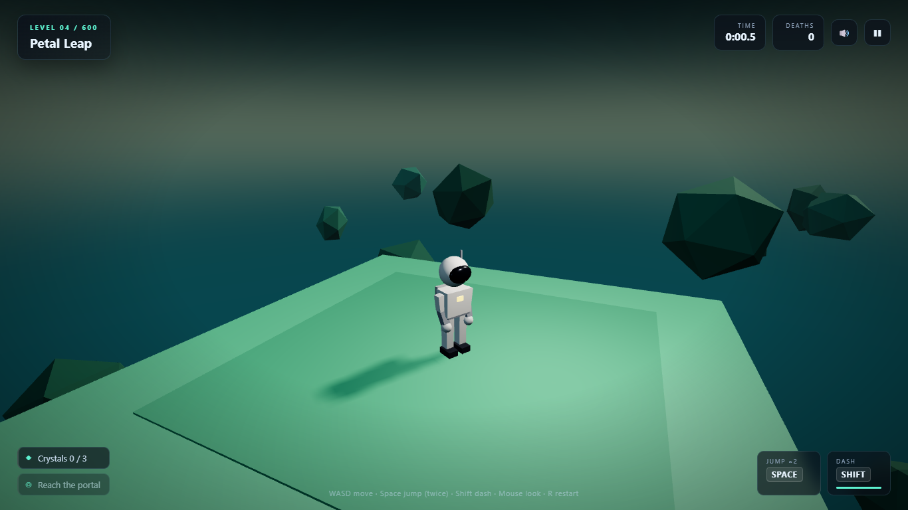
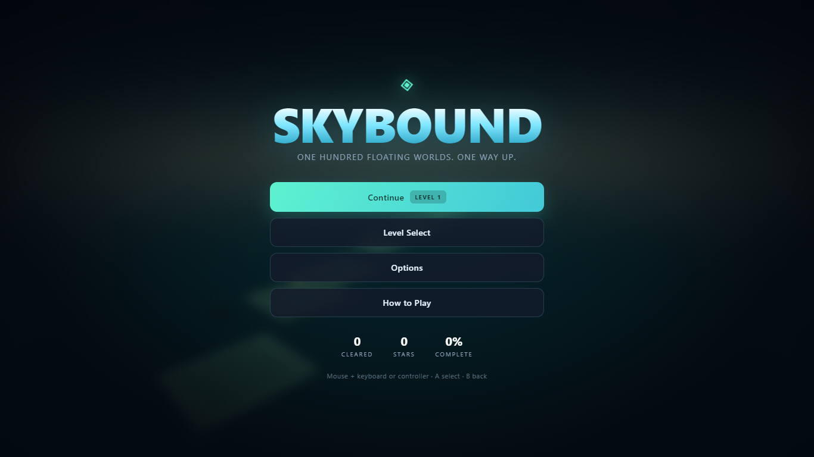
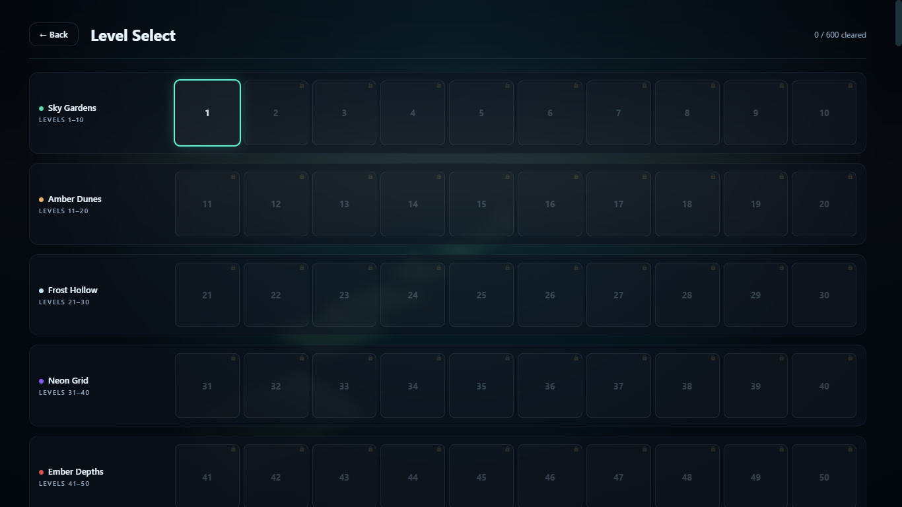
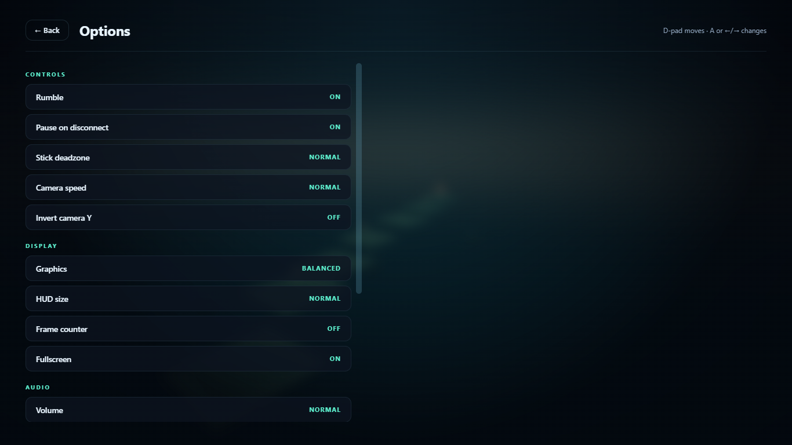

# SKYBOUND

**An open-source 3D platformer about climbing home through six hundred floating worlds.**

SKYBOUND is a small, fast, third-person platformer. You play a tiny astronaut hopping between
drifting islands, collecting crystals, flicking switches and diving through a portal at the end of
each course. Everything runs offline, saves to the machine it runs on, and is playable start to
finish from a controller alone — including the menus.

The whole thing is MIT licensed. Source, art pipeline and build scripts are all in this repository.



## Contents

- [Platforms](#platforms)
- [Screenshots](#screenshots)
- [Features](#features)
- [Controls](#controls)
- [Download](#download)
- [Building from source](#building-from-source)
- [Project layout](#project-layout)
- [Known issues](#known-issues)
- [License](#license)

## Platforms

| Platform | Status | Notes |
| --- | --- | --- |
| **Windows** | ✅ Available | Portable `.exe`, no installer, no admin rights. Comes up fullscreen. |
| **Android** | ✅ Available | Signed `.apk`, phone and tablet, touch controls. |
| **Nintendo Switch (homebrew)** | 🚧 **Platform layer only** | [`switch/`](switch/README.md) compiles to a working `.nro` harness (window, pad, main loop). The game itself is not ported. |

To be explicit, because it is easy to misread a table like this: **there is no playable Nintendo
Switch build of SKYBOUND.** The web build is JavaScript on top of WebGL, and homebrew on Switch has
no browser or WebGL, so the game needs a native rewrite. What exists in [`switch/`](switch/README.md)
is the first step of that rewrite — a devkitA64/libnx project that builds a real `.nro` and brings up
the display and the pad. The renderer, level generation, physics and menus are still to come, and no
`.nsp` exists or can exist without console keys.

## Screenshots

| Menu | Level select |
| --- | --- |
|  |  |

| Options | Gameplay |
| --- | --- |
|  |  |

## Features

- **600 levels** generated from a deterministic seed, laid out across distinct floating themes —
  every run of the same level is identical, so times are comparable.
- **Moment-to-moment platforming**: run, double jump, air-dash, bounce pads, conveyors, moving
  platforms, lasers and checkpoints.
- **Stars per level** based on time and deaths, with the par time shown on the results screen.
- **Full controller support**, menus included: a focus ring walks every screen, A activates,
  B backs out, and the pad can reach the pause list, options, level grid and results screen.
- **Controller-aware options**: rumble, stick deadzone, camera speed, invert Y, and pause-on-
  disconnect (unplug mid-run and the level pauses rather than killing you blind).
- **Couch-friendly display options**: graphics preset, HUD size up to TV scale, frame counter and a
  fullscreen toggle driven through the desktop shell rather than the browser API.
- **Everything is local**: no accounts, no network calls, no telemetry. Progress lives in
  `localStorage` on the device.
- **No build step for the game itself** — plain ES modules and a vendored Three.js, served as
  static files.

## Controls

### Keyboard and mouse

| Action | Input |
| --- | --- |
| Move | `W` `A` `S` `D` |
| Jump / double jump | `Space` |
| Dash | `Shift` |
| Camera | Mouse |
| Restart level | `R` |
| Pause | `Esc` |
| Mute | `M` |
| Fullscreen | `F` (in game), `F11` (desktop build) |

### Gamepad (standard mapping)

| Action | Input |
| --- | --- |
| Move | Left stick or d-pad |
| Camera | Right stick |
| Jump / confirm | `A` |
| Back / cancel | `B` |
| Dash | `X`, `RB` or `RT` |
| Pause | `Menu` / `Start` |

Menus are navigable with the d-pad or left stick; up and down hop a row on grids, left and right
step one item, and `B` backs out of any screen.

## Download

Grab the latest build from the **Releases** tab of this repository:

- **Windows** — `SKYBOUND-<version>-portable.exe`. Run it; nothing is installed.
- **Android** — `SKYBOUND-<version>.apk`. Sideload it; the APK requests no network permission.

> **Pre-release software.** The current release is marked as a pre-release on purpose: it is prone
> to bugs, balance changes and save-format changes between versions. Expect rough edges.

## Building from source

Requirements: **Node.js 20+** and npm. For the Android build you also need a JDK and an Android SDK
(build-tools 35 and a recent platform).

```bash
npm install

# play in a browser (no build step)
node server.js          # then open http://localhost:5173

# Windows: portable .exe -> release/
npm run portable

# Android: signed .apk -> project root (needs the SDK paths in tools/build-apk.sh)
bash tools/build-apk.sh
```

There is also a headless level checker that walks every generated course and reports impossible
jumps and stuck spots:

```bash
node tools/playtest.mjs
```

## Project layout

```
index.html          markup for the game shell and every menu screen
styles.css          all UI styling, including the controller focus ring
server.js           tiny static server used for development
js/main.js          game state, menus, input, options, save data, controller navigation
js/player.js        physics, collisions and the astronaut's animation
js/astronaut.js     the playable character, built procedurally from primitives
js/world.js         platforms, hazards, pickups, portal and particles
js/levelgen.js      deterministic level generation and the world scale
js/fx.js, js/audio.js, js/rng.js, js/mobile.js
electron/           desktop shell: window, fullscreen bridge, smoke probe
android/            WebView wrapper used by the APK build
tools/              build scripts, icon generator and the level playtester
vendor/             vendored Three.js
```

## Known issues

- This is a pre-release: expect crashes, soft-locks and geometry that occasionally traps you.
- Some level seeds can put a platform close enough to a hazard that the intended route is brutal.
- The Android build is verified as packaged, not on a wide range of devices.
- The in-game About panel still reads "100 levels across ten themes" from an earlier version; the
  game has 600.

If you hit something broken, please open an issue with the level number and what happened.

## License

[MIT](LICENSE). Use it, fork it, ship it, sell it — just keep the copyright notice. Contributions
are welcome under the same terms.
